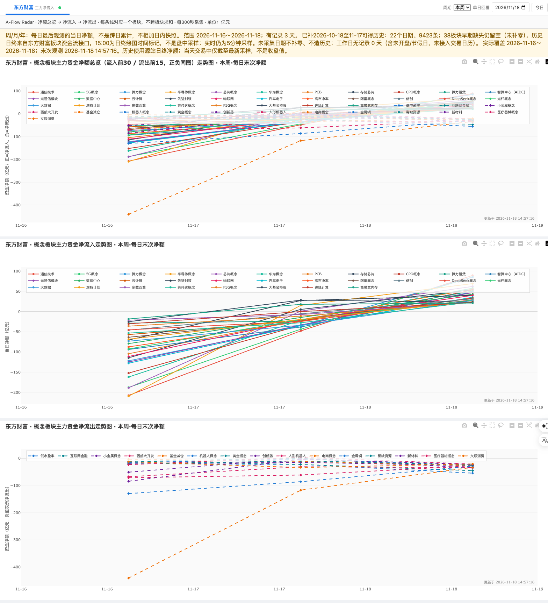
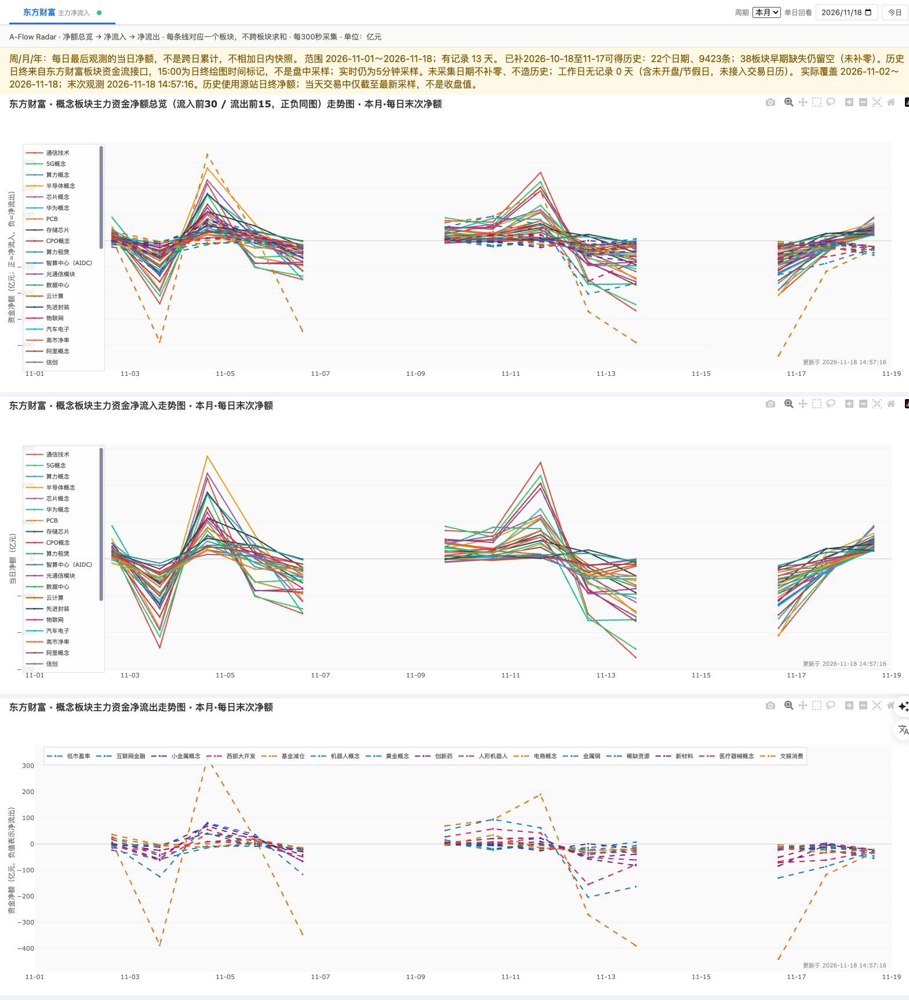

# A-Flow Radar
A-share concept-sector main net fund-flow dashboard. Derived from cn-sector-fund-flow; see UPSTREAM.md.

## Features
Three charts: signed overview, positive net inflow, negative net outflow. Single-curve hover. Today/week/month/year views. 300-second sampling during weekday Chinese market hours (Asia/Shanghai). No exchange holiday calendar.
Week/month/year show the latest observed DAILY net amount for each board, never a sum of intraday cumulative snapshots. Missing dates stay null. Sectors overlap: do not sum boards to infer total-market flow. Positive top30 and negative top15 are ranked by the latest available date.
Historical daily-close files, if independently obtained lawfully, belong in data/history_daily/fund_flow_YYYYMMDD.json. No history is shipped. Historical 15:00 is a plotting marker, not a measured timestamp. Today uses live data; prior days can use provider daily close alongside retained live snapshots.

## Screenshots
Actual running dashboard captured on 2026-11-18, showing the latest available sample at 14:57:16 Asia/Shanghai. These are saved snapshots, not live quotes or confirmed market-close data. The three panels show signed net amounts, positive net inflow, and net outflow.

### This week
Three dates with records.


### This month
Thirteen dates with records. Missing historical dates remain missing, not zero.


## Deploy
Requires Docker Engine and Docker Compose v2. The pinned official Python base was tested on Linux ARM64; verify platform support before deploying elsewhere.
1. From the repository root, run sudo python3 scripts/init_auth.py. Choose a unique strong password. This creates ignored credentials and data directories owned by container UID10001.
2. docker compose up -d --build
3. Open http://127.0.0.1:8899 and authenticate.
4. docker compose ps; docker compose logs --tail 30
Do not put credentials in commands, URLs, Git or screenshots. Compose binds localhost only. HTTP Basic authentication is NOT encryption. For remote use, configure TLS through your approved infrastructure or use an authenticated SSH tunnel; do not expose plaintext credentials over an untrusted network.

## Isolation and data
Limits: 1 CPU / 1 GiB / 64 PIDs; read-only filesystem, dropped capabilities, no-new-privileges. Only data and charts volumes are writable. Credentials are mounted read-only. All pages, APIs and static resources require authentication. A dedicated local health token is used by Docker.
Health reports collection freshness, not financial-data correctness. Before the first sample of a new day, health may be unhealthy even when the web server is up. No automatic deletion of old records. Monitor disk growth.
Endpoint stability and correctness are not guaranteed. This is a monitoring tool, not investment advice or an order-execution system.

## Test and stop
```sh
docker compose build
docker run --rm --user 0 --network none --cpus 0.5 --memory 512m --pids-limit 64 --cap-drop ALL --security-opt no-new-privileges -e OPENBLAS_NUM_THREADS=1 -e OMP_NUM_THREADS=1 -e MKL_NUM_THREADS=1 -e NUMEXPR_NUM_THREADS=1 --entrypoint python -v "$PWD/tests:/tests:ro" aflow-radar:local /tests/smoke.py
docker compose down
```
The freshly built Linux ARM64 image passed isolated offline smoke tests on 2026-11-18: anonymous requests return 401, authenticated page/data/dates/static requests return 200, daily views use the last snapshot and missing days remain null. This test uses synthetic data and binds no host port. Compose already limits numeric-library threads to one; keep the same environment for direct docker run tests on many-core hosts.
Stopping/removing the service does not delete bind-mounted data. Keep backups before upgrading. No host firewall, proxy, DNS or unrelated services need changes.

## License / dependencies
See UPSTREAM.md and THIRD_PARTY.md. No secrets, deployment-specific addresses, datasets, logs, binaries or backups are included.
